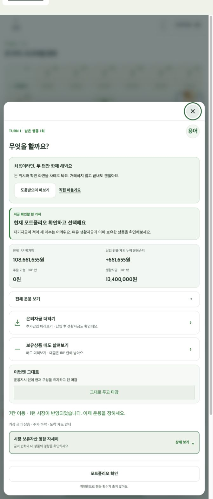
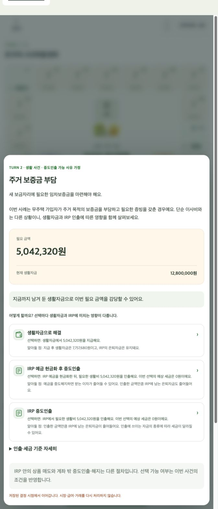

# FB-042~045 구현 기록

2026-09-29 · 로컬 구현 및 검증 완료. 운영 배포 전.

## 반영 사항

- FB-042: 운용창 자금 요약에 전체 IRP 평가액과 납입·인출을 제외한 누적 운용손익을 추가했다. 기존 주문 가능 자금과 생활자금도 유지했다. 전체 IRP에는 기존 평가 함수가 집계하는 보유·대기·미결제 자금이 포함되며 생활자금은 제외한다. 손익 = 현재 IRP 평가액 − 시작 IRP − 누적 외부 현금흐름(납입·이전은 양수, 인출은 음수). 생활자금 이동을 투자수익으로 오인하지 않는다.
- FB-043: 시작 기본점수 4점은 기존 규칙이므로 유지했다. 기본점수와 퀴즈 획득점수를 따로 표시해 정답 0개에서 4/20점인 이유를 설명한다. 기존 비캠페인 판의 이해·리밸런싱 점수와 위반 감점도 표시한다.
- FB-044: 진행 중인 일에 현재 N/12턴을 추가했다. 주문 접수·가격 확정·결제 일정은 유지했다.
- FB-045: 미해결 생활사건이 있을 때 하단 버튼으로 선택창에 다시 진입할 수 있다. 조회창을 닫으면 사건 선택창으로 복귀하고, 저장판 복원 시 선택창이 누락된 상태를 복구한다. 도착 연출·속보·퀴즈 등 기존 진행 순서는 유지한다. 복구 과정에서 사건, 시장, 급여, 주문을 다시 처리하지 않는다.

기존 글꼴·글자 크기와 매매·결제·점수 규칙은 변경하지 않았다.

## 검증

- 전체 자동 테스트: 83개 파일, 801개 테스트 통과.
- 빌드 및 lint 통과. 기존 번들 크기 경고 외 실패 없음.
- 신규 회귀 테스트: 생활사건 재진입, 조회창 3종에서 복귀, 저장 복원, 속보·도착 대기 우선순위, 시작 점수, 외부 현금흐름 제외 손익, 현재 턴과 결제 일정 표시.
- 로컬 브라우저의 운용창에서 전체 IRP 108,661,655원 / 누적 운용손익 +661,655원 / 주문 가능 0원 / 생활자금 13,400,000원을 확인했다. 브라우저 오류 로그 없음.
- 생활사건 누락은 상태 전이 회귀 테스트로 검증했다. 사용자의 최초 발생 조작을 실기기에서 재현한 것은 아니며 실제 iPhone·Windows Edge 검증과 운영 배포는 포함하지 않는다.

## 생활사건 문구 후속 개선 및 출시 검증

- 생활사건 12종 본문을 부드러운 안내로 변경. 의료비·보증금·퇴직금은 문단 분리.
- 선택 카드의 지금/나중을 선택하면/알아둘 점으로 변경. 선택 전에는 예상 결과로 설명하고, 실제 처리 완료 메시지는 유지.
- 지출 9종의 지급 후 생활자금·미지급액·예상 세금을 현재 상태로 표시. 인출·세금 기준은 접이식 안내.
- 보너스·성과급 3가지 선택과 퇴직금 정산 2가지 선택의 안내를 개편. 세액공제 0원·납입 한도·생활자금 0원 분기 포함.
- 게임 기준 예상 월 연금 증가를 별도 줄로 표시. 인출 불가 사유 4종도 같은 말투로 수정.
- 최종 검증: 83개 파일 802개 테스트 통과 (`npm test -- --maxWorkers=2`), build/lint 통과. 최초 병렬 실행의 2개 시간 초과는 동시 실행 수를 줄여 재검증. 변경 문구를 참조하는 기존 테스트 기대값 갱신.
- 로컬 브라우저에서 저장된 2턴 생활사건을 복원하고 새 안내, 지급 후 잔액 7,757,680원, 예상 세금 0원을 확인. 거래 선택은 실행하지 않음.

