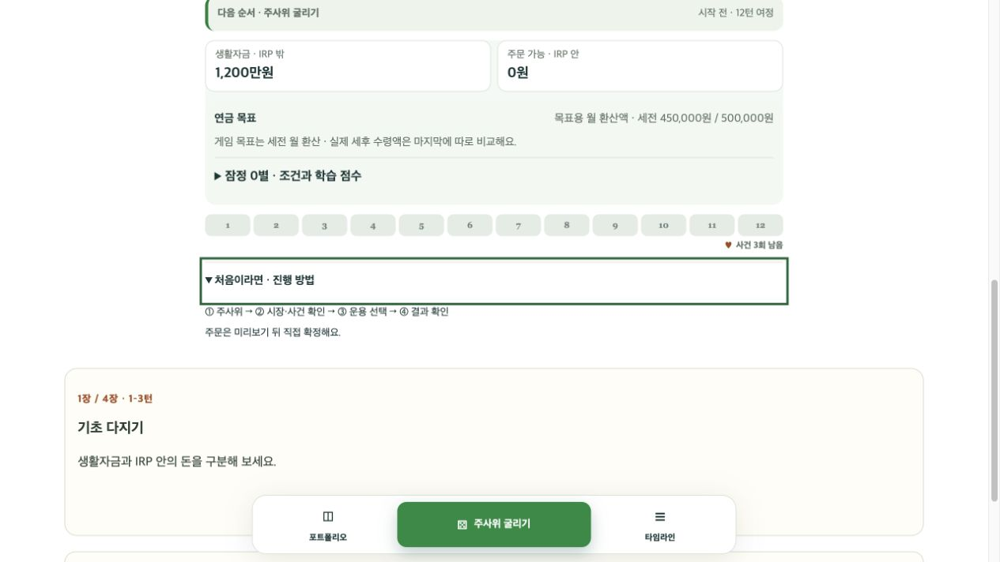

# FB-046~048 구현

2026-09-29. 로컬 구현·검증 완료, 운영 배포 전.

- FB-046 A안: 보드 발견 정보 다음에 현재 행동·턴 안내, 생활자금/주문 가능 자금, 목표/점수, 12턴 진행, 첫 턴의 접이식 진행 방법 순으로 배치. 기존 하단 실행 버튼 유지. 글꼴·기존 금액 크기 및 금융·점수 계산 유지.
- FB-047: 작은 탐험의 주제·단서·질문·정답 기록, 기념카드 획득, 게임/결과 앨범 및 이벤트 처리 제거. 장별 목표·목표 회복 안내 유지. 과거 uiProgress.journey는 정규화에서 무시하고 다른 UI 확인 기록과 GameState는 그대로 복원.
- FB-048: 결과 화면의 지역 이유 남기기와 관련 문장 제거. 구버전 지역 도장 획득 조건 및 route.reflections 저장 호환성은 유지. 업적·지역 도장·정식 학습 카드/퀴즈·브랜드 그림·IRP 흐름 그래프 유지.
- 현재 사용자 매뉴얼의 폐기된 이유 남기기 안내 수정.

## 검증

- 전체 83개 파일, 804개 테스트 통과.
- 빌드 및 lint 통과. 기존 500kB 번들 크기 경고는 남음.
- 기존 0/1/4개 기념카드 저장판 복원에서 금융 상태·점수·다른 안내 확인 기록 보존 검사.
- A안 순서, 접힌 시작 안내, 탐험 미노출, 장별 목표·결과 도장 보존 검사.
- 로컬 브라우저의 별도 localhost 주소에서 검증용 새 판 생성. 127.0.0.1의 기존 진행은 대체하지 않음. 새 화면 및 진행 안내 펼침 확인, 브라우저 오류 없음.
- 이번 턴에 실제 iPhone/Windows Edge 검증 및 운영 배포는 수행하지 않음.

